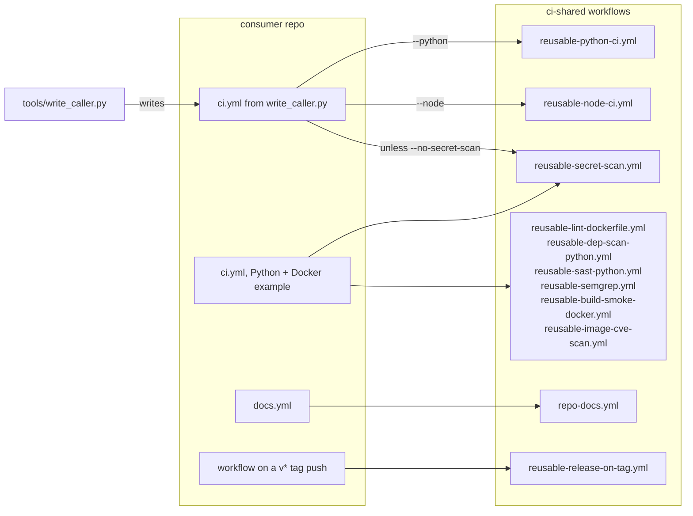
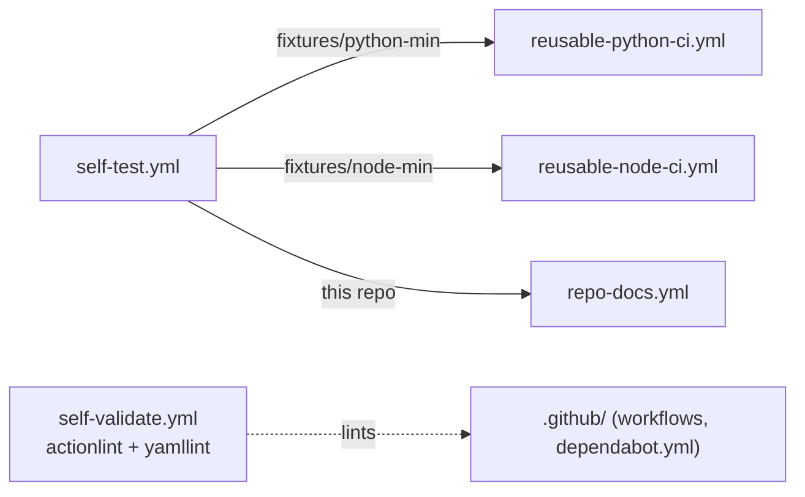

# salucallc/ci-shared

Reusable GitHub Actions workflows for [salucallc](https://github.com/salucallc) repositories. Derived from the `salucallc/gmail-mcp` CI template (Python + Docker security baseline) and generalized so multiple repos can adopt the same gates with a one-line `uses:` reference.

## How it works

How a consumer repo calls these workflows, traced from the workflow files, `tools/write_caller.py` and the caller examples in this README. Every arrow from a consumer is a `uses: salucallc/ci-shared/.github/workflows/<file>@<full commit sha>` line; the labels on the `ci.yml` arrows are the `write_caller.py` flags that add each job. No reusable workflow calls another reusable workflow: every `uses:` inside them is a third-party action pinned to a commit SHA.



## Status

Maintained. Ten reusable workflows (`reusable-*.yml`) plus `repo-docs.yml`, all invoked with `workflow_call`. `self-validate.yml` runs actionlint and yamllint over `.github/` on every PR, and `self-test.yml` runs the Python and Node stack workflows against `fixtures/` and `repo-docs.yml` against this repo. The other workflows are exercised by the repos that call them, not by this repo's CI.

`repo-docs.yml` and `merge-gate.yml` are new and not yet called by any repo. `self-test.yml` runs the gate's own tests and `merge-gate.yml` against this repo.

### Corrections, 2026-10-22

- This README listed `image-tag` as an input of `reusable-build-smoke-docker.yml`. The input is `image-name`.
- This README listed `image-ref` as an input of `reusable-image-cve-scan.yml`. That workflow has no `image-ref` input: it takes `context`, `dockerfile` and `image-name` and rebuilds the image itself before scanning.
- This README said Dependabot is configured for the `github-actions` and `pip` ecosystems. `.github/dependabot.yml` configures `github-actions` only; pinned pip tools are bumped by hand (see Pinning policy).
- This README said every callable workflow grants `contents: read` per job. `reusable-release-on-tag.yml` grants `contents: write`, which creating a release needs; the Architecture list now says so.
- The example consumer workflow below had a `ci-all` fan-in job with `needs:` and no `if: always()`. When a needed job fails, such a job is skipped, and GitHub reports a skipped job as passing a required check, so a failing PR could merge. The example now uses the same fan-in pattern as `self-validate.yml`.

## Install

Nothing to install. A consuming repo references a workflow by commit SHA in its own `.github/workflows/*.yml`. The helper scripts in `tools/` use the Python standard library only (tested with Python 3.12); `tools/ci_inventory.py` also needs an authenticated `gh` CLI.

## Quickstart

Write a stack CI caller for a repo, pinned to a ci-shared commit:

```console
$ python tools/write_caller.py demo --branch main --sha ee9a171f6e0518a6442aada81194a2a8148e57ff --python .
demo/.github/workflows/ci.yml
```

The file it wrote (real output, 2026-10-22):

```yaml
# CI via salucallc/ci-shared reusable workflows (pinned by commit SHA).
# Inputs, adoption and re-pinning: see the salucallc/ci-shared README.
name: CI

on:
  pull_request:
  push:
    branches: [main]
  workflow_dispatch:

concurrency:
  group: ${{ github.workflow }}-${{ github.ref }}
  cancel-in-progress: ${{ github.event_name == 'pull_request' }}

permissions:
  contents: read

jobs:
  python:
    uses: salucallc/ci-shared/.github/workflows/reusable-python-ci.yml@ee9a171f6e0518a6442aada81194a2a8148e57ff
  secret-scan:
    uses: salucallc/ci-shared/.github/workflows/reusable-secret-scan.yml@ee9a171f6e0518a6442aada81194a2a8148e57ff
```

A SHA that is not 40 hex characters is refused (`--sha must be a full 40-character commit SHA`, exit 1). The script checks the format only; it does not check that the commit exists on ci-shared `main`.

## Usage

All workflows live in `.github/workflows/` and are invoked with `workflow_call`. Consuming repos reference them by SHA, not tag, to avoid tag-force-push supply-chain risk. Dependabot in this repo bumps pinned third-party action SHAs; consumers should run their own Dependabot to bump the pinned SHA of THIS repo they consume.

### Reusable workflows

Every workflow below also takes `runs-on` (default `ubuntu-24.04`).

| Workflow | Purpose | Key inputs |
|---|---|---|
| `reusable-lint-dockerfile.yml` | Hadolint Dockerfile lint | `dockerfile` (default `Dockerfile`), `failure-threshold` (default `warning`) |
| `reusable-dep-scan-python.yml` | pip-audit + safety CVE matrix | `requirements-file` (default `requirements.txt`), `python-version` (default `3.12`) |
| `reusable-sast-python.yml` | Bandit SAST | `target-paths` (default `.`), `severity-level` (default `medium`), `confidence-level` (default `medium`) |
| `reusable-semgrep.yml` | Semgrep OWASP/Python/secrets/CI rulepacks | `configs` (default set), `severity` (default `ERROR`), `semgrep-version` (default `1.160.0`) |
| `reusable-secret-scan.yml` | TruffleHog verified-only secret scan | `only-verified` (default `true`), `scan-path` (default `./`) |
| `reusable-build-smoke-docker.yml` | Buildx smoke build of a Dockerfile | `context` (default `.`), `dockerfile` (default `Dockerfile`), `image-name` |
| `reusable-image-cve-scan.yml` | Rebuilds the image locally, then a Trivy scan | `context`, `dockerfile`, `image-name`, `severity` (default `HIGH,CRITICAL`), `ignore-unfixed` (default `true`), `vuln-type` (default `os,library`) |
| `reusable-release-on-tag.yml` | Release + changelog on `v*` tag push | `changelog-path` (default `CHANGELOG.md`), `prerelease`, `generate-release-notes` |
| `reusable-python-ci.yml` | Install (uv / poetry / pip, from the lockfile), `compileall`, `pytest` when tests exist | `python-version` (default `3.12`), `working-directory`, `install-command`, `compile-command`, `test-command`, `extra-packages`, `apt-packages` |
| `reusable-node-ci.yml` | Install (npm / pnpm / yarn, frozen lockfile), typecheck, build, test | `node-version` (default `22`), `working-directory`, `install-command`, `typecheck-command`, `build-command`, `test-command` |
| `repo-docs.yml` | README and `llms.txt` shape check, em-dash check, gitleaks over full history | `required-headings`, `check-em-dash` (default `true`), `run-gitleaks` (default `true`) |
| `merge-gate.yml` | The merge gate: every automated check of the estate merge standard, one job each, plus a fan-in (`Merge gate all`) | `gate-ref` (the same SHA as `uses:`), `python-ci`, `node-ci` (`auto` or `skip`), `sast` (default `true`) |

The two stack workflows take `auto`, `skip` or a shell command for each step. `auto` detects from
the repo; `skip` logs that the step did not run. A step that found nothing to run says so with a
notice rather than passing silently. `self-test.yml` runs both against `fixtures/` on every PR.

**A Python project means a marker at the repo root** (`pyproject.toml`, `setup.py`, `setup.cfg` or
`requirements*.txt`), because `reusable-python-ci.yml` installs from a root manifest and then runs
`pytest` at the root. A repo whose requirements live in a subdirectory therefore does not get
`python-tests`, and the gate now names that subdirectory in a notice instead of skipping in
silence, so nobody has to guess whether the tests ran somewhere else. They have to run in the
repo's own workflow. `gate detect` writes the path to the `python_marker` output for the same
reason.

### Adopting the stack CI (the estate's default)

```yaml
# .github/workflows/ci.yml
name: CI
on:
  pull_request:
  push:
    branches: [main]
  workflow_dispatch:
permissions:
  contents: read
jobs:
  python:
    uses: salucallc/ci-shared/.github/workflows/reusable-python-ci.yml@<commit-sha>
  secret-scan:
    uses: salucallc/ci-shared/.github/workflows/reusable-secret-scan.yml@<commit-sha>
```

This repo is public, so private repos in both `salucallc` and `saluca-labs` can call it (a private
reusable workflow could only be shared inside its own org).

### Docs check for public repos (`repo-docs.yml`)

For a public repo, add `.github/workflows/docs.yml`:

```yaml
name: docs
on: [push, pull_request]
permissions:
  contents: read
jobs:
  docs:
    uses: salucallc/ci-shared/.github/workflows/repo-docs.yml@<commit-sha>
```

It fails when:

- `README.md` is missing, has no H1, lacks a required `## ` heading (prefix match, case-insensitive), or lacks a `_Last updated: YYYY-MM-DD_` line. The default headings are `Status,Install,Quickstart,Usage,Citation,License,Links`.
- `llms.txt` is missing or not in [llmstxt.org](https://llmstxt.org) shape: an H1 first, a `> ` summary within the next three non-blank lines, at least one `## ` section and at least one `- [name](url)` link.
- `README.md`, `llms.txt` or `AGENTS.md` contains an em-dash (U+2014), unless `check-em-dash: false`.
- gitleaks finds a secret anywhere in git history, unless `run-gitleaks: false`. gitleaks 8.30.1 runs from its release binary after a SHA-256 check, not through `gitleaks-action`, which needs a paid licence key for organisation accounts. Reviewed false positives go in the calling repo's `.gitleaksignore`, one fingerprint per line, with a comment saying why. That file is excluded from the scan (path allowlist in `gate/gitleaks.toml`), because explaining a false positive means quoting the shape being dismissed, and the gate must not block on the remedy file it prescribes. An entry with no reason above it is still a block.

A data-only repo can narrow the headings:

```yaml
jobs:
  docs:
    uses: salucallc/ci-shared/.github/workflows/repo-docs.yml@<commit-sha>
    with:
      required-headings: "Status,Usage,Citation,License,Links"
```

### Merge gate (`merge-gate.yml`, `gate/`)

The estate's last check before anything merges: every automated requirement of the merge
standard (saluca-handoff `KB/workflows/repo-merge-gate.md`), one CI job each, and the same code
runnable before a push. It is new and not yet called by any repo.

Adopt it with one caller file, pinned to the same SHA twice:

```yaml
# .github/workflows/merge-gate.yml  (python tools/write_caller.py <repo> --branch main --sha <sha> --merge-gate)
jobs:
  gate:
    uses: salucallc/ci-shared/.github/workflows/merge-gate.yml@<commit-sha>
    with:
      gate-ref: <commit-sha>
```

Branch protection then requires one check, `gate / Merge gate all`, the fan-in. It fails when a
job fails, is cancelled, or is skipped when it should have run. `tools/branch_protection.py`
prints the protection it would set for each public repo; it changes nothing without `--apply`.

What each job checks (the requirement ids are the standard's):

| Job | Ids | Fails when |
|---|---|---|
| `secrets` | SEC-1..4 | gitleaks 8.30.1 (checksum-verified, estate rules in `gate/gitleaks.toml`) finds a secret in any commit of any ref; or the stdlib sweep finds a k8s Secret `data:` value that decodes to a real value, a database URL with a real password, a secret-shaped value in an env template, or a committed `.env`, key or service-account file, in the tree or in any history blob |
| `paths` | TST-3, EXP-1 | an estate path or tailnet host anywhere; an absolute drive or home path in code or config |
| `control-chars` | TST-4 | a control character that a mangled backslash escape leaves (TAB after text in Python or JS, 0x07, 0x08, 0x0B, 0x0C), a bare CR, or an invisible or bidi character |
| `style` | STY-1, STY-3 | an em-dash in any prose file (the one exception is the "Saluca Labs" sign-off, alone or as an HTML element whose whole text it is); a shell, Dockerfile or cron file stored with CRLF or not LF-pinned in `.gitattributes` |
| `test-markers` | TST-1, TST-2 | source code with no tests; a skip or xfail without a reason and an issue link; a bulk xfail; more than 10 markers |
| `claims` | CLM-1..7 | no `CLAIMS.md`, or a claim row whose text is not in its source doc, whose code or test does not exist, whose code is a stub, whose mount point does not contain the named text, whose test is skipped, which is `planned` but read as working, or which is withdrawn with no dated correction note |
| `packaging` | PKG-1, PKG-2 | a README install line names a package its registry does not have (PyPI, npm, crates.io), unless the README says it is not yet published |
| `licence` | LIC-1..4 | no licence file; the README, package metadata, CITATION.cff, `.zenodo.json`, NOTICE or the Zenodo record disagree with it; a change in the last 90 days has no dated note |
| `ci-hygiene` | CI-1..5 | no CI on pull requests, no test run, `continue-on-error`, a failure swallowed with `\|\| true`, or the gate not adopted |
| `branch-protection` | CI-6 | the default branch is unprotected, or does not require the gate (a repo setting, read live) |
| `deps` | DEP-1..3 | Node dependencies with no lockfile; pip-audit or npm audit finds a vulnerability with a released fix |
| `security` | SEC-5..8 | proxy code forwards the incoming headers upstream; a secret reaches a log; auth defaults off, or an unauthenticated mode has no test; code writes another tool's user config without consent and a backup |
| `log-redaction` | SEC-9 | code generates keys and no test proves a key never reaches a log |
| `consistency` | CON-1, CON-2 | warnings only: a home-grown hash chain, or one with no truncation test (the estate format is an open decision) |
| `mutation` | TST-5 | opt-in: no mutant of a declared target is caught, so its tests pass whatever the code does |
| `docs` | DOC-1 | `repo-docs.yml`, called with its em-dash and gitleaks steps off because `style` and `secrets` cover them |
| `python-tests`, `node-tests`, `bandit`, `semgrep` | TST-1, SEC-10 | the existing stack and SAST workflows, called when the stack is detected |

The gate fails closed. A tool it cannot run, a registry it cannot reach, or a file it cannot read
is cannot-tell (exit 2), which fails the gate, never a pass.

### Reviewed fixtures: two files, two checks

A test that injects a credential-shaped value on purpose is not an incident, but the two secret
checks need telling separately. They are two files on purpose: SEC-1 is a third-party scanner, and
SEC-2 is the stdlib sweep that exists because the gate does not trust one scanner's judgement.
One file would let the weaker check's remedy silence the stronger one.

`.gitleaksignore` excuses a SEC-1 finding, one fingerprint per line, each under a comment saying
why. `.secrets-reviewed` excuses a SEC-2 **history** finding, one entry per line, in the form
`<fp12> <path>`, each under a comment saying why. `fp12` is the 12 characters the gate prints in
the finding, `<path>` is the repo-relative path it names.

```console
$ cat .secrets-reviewed
# Synthetic fixture, not a credential: tests/test_redactor.py injects this DSN to prove the
# redactor masks it. Nothing here is live.
0f1e2d3c4b5a tests/test_redactor.py
```

What an entry cannot do, by construction:

- **It cannot reach the tree.** A value still present in the HEAD tree is refused, and the tree
  finding stands. Reviewing a fixture you can still delete invites leaving it in the copy that
  ships; the entry only ever excuses a blob you cannot edit without rewriting history.
- **It cannot name a rule, directory, glob or pattern.** The key is `(fp12, path)`, and `fp12` is a
  hash of the value, so an entry written for one value cannot be repointed at another.
- **It cannot be silent.** A matched entry still prints a warn naming the file and line, so the
  excuse is visible in the run. An entry that matches nothing prints a note telling you to delete
  it, and a malformed line is a block.
- **It cannot be reached from `.gate.toml`.** `secrets` is in both `NO_WAIVE` and `NO_BASELINE`, and
  neither file is read by `gate/cli.py`.

Never quote a secret value, or a shape a scanner matches, in either file's reason comment. Describe
what the value is and point at the test that uses it. `.gitleaksignore` is excluded from the
gitleaks scan because explaining a false positive means quoting what was dismissed; `.secrets-reviewed`
is not excluded, so a real-looking value written there is still a finding.

Run it before a push (Python 3.11+, standard library only):

```console
$ python tools/gate.py bootstrap          # once: pinned gitleaks and a pip-audit venv in ~/.cache/saluca-gate
$ python tools/gate.py run --repo ../my-repo
```

or install the hooks in `.pre-commit-hooks.yaml` (`examples/pre-commit-config.yaml`): a fast
pre-commit hook on staged files, and a pre-push hook that runs the whole gate.

A repo's `.gate.toml` cannot switch a check off or lower a severity. It can waive one named
finding, with a reason, a GitHub issue link and an expiry date of at most a year, and the waiver
is printed on every run. Secrets cannot be waived. Pre-existing findings can be recorded once in
`.gate-baseline.json` (`python tools/gate.py baseline`) so that adopting the gate does not freeze a
repo; on a pull request the baseline may only shrink.

`gate/tests/test_gate.py` holds a fixture that must fail and one that must pass for every check.
The fixtures plant a fake secret with a fake prefix, a hardcoded path, an xfail with no reason, an
install line for a package that is not on PyPI, and a broken claims reference, among others. Each
check was also sabotaged in a copy of the gate, and its tests went red every time.

### Tools

`tools/write_caller.py` writes the stack CI caller file for a repo (`--node DIR[:k=v,...]`, `--python DIR[:k=v,...]`, `--branch`, `--sha`, `--no-secret-scan`, `--force`); it refuses a SHA that is not a full 40-character commit, and refuses to overwrite an existing `ci.yml` without `--force`.

`tools/ci_inventory.py` lists every repo in both orgs with its stack, workflows, default-branch CI
state and open dependency PRs (read-only, through `gh`).

### Example consumer workflow (Python + Docker)

```yaml
# .github/workflows/ci.yml in a consuming repo
name: CI
on:
  push:
    branches: [main]
  pull_request:
    branches: [main]
concurrency:
  group: ${{ github.workflow }}-${{ github.ref }}
  cancel-in-progress: ${{ github.event_name == 'pull_request' }}
permissions: read-all
jobs:
  lint-dockerfile:
    uses: salucallc/ci-shared/.github/workflows/reusable-lint-dockerfile.yml@<commit-sha>
  dep-scan:
    uses: salucallc/ci-shared/.github/workflows/reusable-dep-scan-python.yml@<commit-sha>
  sast:
    uses: salucallc/ci-shared/.github/workflows/reusable-sast-python.yml@<commit-sha>
  semgrep:
    uses: salucallc/ci-shared/.github/workflows/reusable-semgrep.yml@<commit-sha>
  secret-scan:
    uses: salucallc/ci-shared/.github/workflows/reusable-secret-scan.yml@<commit-sha>
  build-smoke:
    uses: salucallc/ci-shared/.github/workflows/reusable-build-smoke-docker.yml@<commit-sha>
  image-cve-scan:
    uses: salucallc/ci-shared/.github/workflows/reusable-image-cve-scan.yml@<commit-sha>
  ci-all:
    needs: [lint-dockerfile, dep-scan, sast, semgrep, secret-scan, build-smoke, image-cve-scan]
    if: ${{ always() }}
    runs-on: ubuntu-24.04
    steps:
      - name: Fail if a required job did not succeed
        if: ${{ contains(needs.*.result, 'failure') || contains(needs.*.result, 'cancelled') || contains(needs.*.result, 'skipped') }}
        run: exit 1
      - run: echo "All required CI jobs succeeded."
```

Make `ci-all` the single required status check in branch protection; adding or renaming reusable workflows will not require touching branch protection. `image-cve-scan` rebuilds the image itself, so it does not need `build-smoke` to run first.

## Architecture

The consumer call graph is under [How it works](#how-it-works). This repo's own CI, traced from `self-test.yml` and `self-validate.yml` (solid arrows are local `uses: ./.github/workflows/...` calls; the dotted arrow is linting only, no call):



The files:

- `.github/workflows/reusable-*.yml`, `repo-docs.yml`: the callable workflows. Each sets `permissions: {}` at the top and grants per job only what that job uses: `contents: read`, except `reusable-release-on-tag.yml`, which grants `contents: write` to create the release.
- `.github/workflows/self-validate.yml`: actionlint 1.7.12 (checksum-verified) and yamllint 1.35.1 with `.yamllint.yml`, plus a `ci-all` fan-in.
- `.github/workflows/self-test.yml`: calls the Python and Node workflows on `fixtures/python-min` and `fixtures/node-min`, and `repo-docs.yml` on this repo, by local path.
- `tools/`: `write_caller.py`, `ci_inventory.py`, `gate.py` (runs the merge gate from a checkout) and `branch_protection.py` (dry-run proposal of the protection to set).
- `gate/`: the merge gate's checks (standard library only), its gitleaks config and its tests. `.pre-commit-hooks.yaml` and `pyproject.toml` exist only so pre-commit can install it.
- `examples/`: the caller workflow, the pre-commit config, a `CLAIMS.md` template and a pull request template with the standard's human-review items.
- `.gitattributes` pins LF line endings.

## Pinning policy

- Third-party actions pinned to a **commit SHA**, never a tag.
- Pinned tools fetched inside workflows (e.g. `semgrep==1.160.0`, actionlint, gitleaks) are bumped in follow-up PRs alongside rulepack review; release binaries are checked against a pinned SHA-256.
- Dependabot is configured for the `github-actions` ecosystem only, weekly.

## Citation

No archived record yet.

## License

MIT. See [LICENSE](LICENSE).

## Links

- [salucallc/.github](https://github.com/salucallc/.github): org-wide community health defaults
- [llmstxt.org](https://llmstxt.org): the `llms.txt` format `repo-docs.yml` checks
- [gitleaks](https://github.com/gitleaks/gitleaks): the secret scanner `repo-docs.yml` runs

_Last updated: 2026-10-22_
